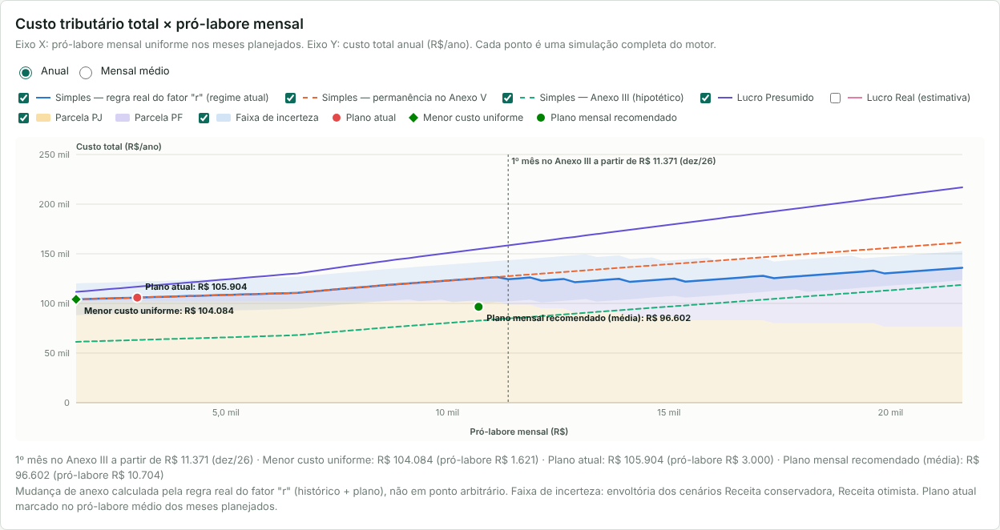

# Simulador Tributário Médico PJ

Aplicação web em **um único arquivo HTML** para planejamento financeiro e otimização tributária de médicos que atuam por pessoa jurídica no Brasil. Compara Simples Nacional (com a regra real do fator "r"), Lucro Presumido e Lucro Real e busca o plano de pró-labore e distribuição de lucros com o **menor custo tributário total em 12 meses**: tributos da empresa + INSS + IRPF + IRPFM + custos administrativos incrementais.

- Arquivo pronto: [`dist/simulador-tributario-medico-pj.html`](dist/simulador-tributario-medico-pj.html) (abra no navegador; não precisa de servidor, instalação ou internet).
- Relatório comparativo do exemplo fictício: [`docs/RELATORIO-EXEMPLO.md`](docs/RELATORIO-EXEMPLO.md) · resultados em CSV: [`docs/exemplo-resultados.csv`](docs/exemplo-resultados.csv).



> Ferramenta de apoio à decisão. Não substitui o contador ou profissional tributário habilitado. Os parâmetros legais foram conferidos apenas em fontes secundárias (as páginas oficiais não estavam acessíveis no ambiente de desenvolvimento): confira antes de decidir.

---

## 1. Como usar

1. Abra `dist/simulador-tributario-medico-pj.html` em um navegador moderno (Chrome, Edge, Firefox ou Safari, no computador ou no celular). Na primeira abertura, carrega um **exemplo fictício** identificado como tal e executa a análise.
2. Substitua os dados pelos seus, aba por aba. Campos vazios são permitidos; cada aba explica o efeito da ausência e o painel mostra a **qualidade dos dados**.

| Aba | O que preencher |
|---|---|
| 1. Painel geral | Indicadores, fator "r" por mês, gráficos dos 12 meses (atual × recomendado), alertas e qualidade dos dados. |
| 2. Perfil da empresa | Ano analisado, mês a partir do qual planejar (meses anteriores ficam como realizados), caixa e reserva mínima, identificação (opcional), natureza jurídica, sócios e participação, regime atual e anterior, contabilidade, perguntas de elegibilidade ao Simples, ISS, equiparação hospitalar, retenções, RAT/FAP/terceiros e custos administrativos incrementais de cada regime. Empresas com menos de 12 meses ganham um bloco de início de atividade. |
| 3. Receitas | Preenchimento fixo, variável ou por cenários; tratamento tributário de cada tipo de receita (anexo do Simples e presunção do Presumido); tabela de 12 meses com consultas, plantões, hospitalar, procedimentos, exames, outras médicas, não médicas, cancelamentos, descontos, outras receitas, recebida e a receber; botões **Duplicar mês**, **Até dez** e **Adicionar receita**; histórico dos 12 meses anteriores (base da RBT12/FS12); resumo com acumulado, RBT12, média, crescimento, maior/menor mês, variação sazonal e projeção. |
| 4. Despesas | Cadastro por categoria (operacionais, transporte, formação, financeiras/investimentos, pessoais) com recorrência, parcelas, reajuste, corte planejado, natureza empresarial/pessoal/mista, uso profissional, titularidade e uso pessoal de veículo, documento, tratamento confirmado ou não. Mostra efeito financeiro e tributário separados. |
| 5. Tributos atuais | Pagamentos, retenções e provisões com competência, data, código de receita e órgão. DARF só é atribuído a um tributo com código reconhecido. Conciliação informado × calculado. |
| 6. Pró-labore e folha | Pró-labore atual, plano mensal, valor efetivamente pago, INSS/IRRF descontados, comprovação; empregados CLT, outros sócios e autônomos; incremento da busca (R$ 100/250/500/1.000 ou outro), mínimo, máximo, variação entre meses, regra de fim de horizonte e materialidade. |
| 7. Pessoa física | Dependentes, pensão, deduções, outras rendas, INSS de outras fontes (teto), carnê-leão, rendimentos isentos e exclusivos, dividendos de outras empresas. Mostra IRRF mensal, IRPF anual (completa × simplificada), antecipações, saldo e IRPFM. |
| 8. Distribuição de lucros | Política (automática, mensal, trimestral, anual ou manual), limite de R$ 50 mil/mês, retenção de lucros, lucros acumulados e saldo de transição (apurados até 2025). Prévia mensal com lucro distribuível, reserva de caixa e retenção. |
| 9. Cenários e otimização | **Executar análise**: gráfico principal, plano recomendado, comparação de cenários, cenários de receita, pontos de equilíbrio, sensibilidade, efeito no ano seguinte, memória de cálculo, alertas e **Salvar cenário para comparar**. |
| 10. Relatório final | Diagnóstico, melhor cenário, comparação financeira, plano de ação e limitações. **Imprimir relatório** gera PDF pelo navegador. |
| 11. Parâmetros legais e fontes | Tabelas, fontes, data de consulta, vigência e status de cada parâmetro; editor JSON para atualizar valores ou criar um novo ano. |

**Salvar e carregar.** Os dados são salvos automaticamente no armazenamento local do navegador (botões **Salvar** e **Carregar** também disponíveis). Eles podem ser perdidos se os dados do site forem apagados: use **Mais → Exportar backup (.json)** e **Importar backup**. **Mais → Limpar dados** pede confirmação.

**Exportar.** **Exportar CSV** (separador `;` e vírgula decimal) traz resumo anual atual × recomendado, cenários, pró-labore mensal, detalhe mensal, curva de otimização e status dos parâmetros.

**Privacidade.** O arquivo tem política de segurança de conteúdo que bloqueia qualquer conexão externa. Não há análise, publicidade ou rastreamento. CPF, CNPJ e nome não são necessários.

### Desenvolvimento

```
src/parametros.js   parâmetros legais por ano (único lugar com alíquotas, faixas e limites)
src/motor.js        motor tributário (funções puras, sem interface)
src/otimizador.js   busca de cenários, sensibilidade, equilíbrio, plano de ação
src/exportacao.js   CSV
src/exemplo.js      dados fictícios de demonstração
src/graficos.js     gráficos SVG sem bibliotecas
src/ui.js           interface
src/estilos.css, src/template.html
scripts/build.js    gera dist/ (arquivo único + variante para publicação hospedada)
```

```
node scripts/build.js            # gera dist/simulador-tributario-medico-pj.html
node --test tests/motor.test.js  # testes do motor e do otimizador
node --test tests/ui.test.js     # teste de interface (Playwright + Chromium)
node scripts/relatorio-exemplo.js
node scripts/capturas.js         # imagens de docs/ (Playwright)
```

---

## 2. Fórmulas implementadas

**Linha do tempo.** Meses do ano analisado `k = 1..12`; histórico de 13 meses (dez/ano−2 e jan–dez/ano−1) para RBT12 e FS12.

**Receita bruta do mês** = Σ receitas por tipo − cancelamentos − descontos incondicionais (rateados entre os tipos). No regime de caixa, a base é a receita recebida, distribuída na proporção dos tipos. "Outras receitas" (financeiras) ficam fora da receita bruta do Simples e entram integralmente na base do IRPJ/CSLL no Presumido e no Real.

**RBT12 e FS12 (Simples).**
- Empresa consolidada (2026): soma dos 12 meses anteriores ao período de apuração. A partir de 2027 (Res. CGSN 190/2026): 12 meses anteriores ao mês imediatamente anterior (defasagem de um mês).
- Início de atividade (Res. CGSN 140, art. 22): 1º mês = receita do próprio mês × 12; meses seguintes = média dos meses de atividade anteriores × 12. A mesma proporcionalização vale para a folha, de modo que o fator "r" = Σ folha ÷ Σ receita dos meses considerados. Em 2027: fator "r" = 0,28 nos dois primeiros meses.
- **Fator "r" = FS12 ÷ RBT12.** FS12 = pró-labore de todos os sócios + salários + 13º + férias + autônomos + FGTS + CPP recolhida fora do DAS. Excluídos: distribuição de lucros, aluguéis, serviços de PJ, INSS retido do sócio (já contido no pró-labore bruto) e CPP contida no DAS. Folha sem receita: r = 0,28.
- Atividade médica (tratamento "fator r"): **Anexo III se r ≥ 28%, Anexo V se r < 28%**.

**DAS.** Alíquota efetiva = (RBT12 × alíquota nominal − parcela a deduzir) ÷ RBT12; DAS = receita de cada atividade × alíquota efetiva do seu anexo, arredondado ao centavo. Repartição por tributo conforme a faixa; ISS limitado a 5% efetivo com transferência proporcional da diferença aos tributos federais; acima do sublimite de R$ 3,6 milhões, ISS fora do DAS pela alíquota municipal; ISS fixo de ME (art. 18, § 18) só com receita anterior ≤ R$ 360 mil.

**Lucro Presumido (trimestral).** Base IRPJ = Σ receita × presunção (32% serviços; 8% hospitalar/diagnóstico só com requisitos confirmados; 8% revenda) + outras receitas; IRPJ = 15% × base + 10% × (base − R$ 20.000 × meses ativos). Base CSLL com 32% (12% hospitalar); CSLL = 9%. LC 224/2025: presunção × 1,10 sobre a receita acumulada que exceder R$ 1,25 milhão por trimestre (CSLL a partir de abril/2026). PIS 0,65% e Cofins 3% mensais (2027: CBS estimada = receita × alíquota de referência × 40% − créditos). ISS municipal ou fixo de sociedade uniprofissional. CPP: 20% sobre pró-labore e autônomos; 20% + RAT × FAP + terceiros sobre salários. IRPJ/CSLL trimestrais são alocados aos meses na proporção da base (só para visualização).

**Lucro Real (estimativa).** LAIR = receitas − despesas operacionais − juros − depreciação − folha − encargos − ISS − PIS/Cofins líquidos − custos administrativos; adições = despesas sem documento ou inaplicáveis; compensação de prejuízo até 30%; IRPJ 15% + 10% acima de R$ 60 mil/trimestre; CSLL 9%. PIS 1,65% e Cofins 7,6% com créditos de 9,25% sobre despesas marcadas como geradoras de crédito; receitas financeiras 0,65%/4%.

**INSS do sócio** = 11% × min(pró-labore, teto − salário de contribuição usado em outras fontes).

**IRRF mensal** = tabela mensal sobre [pró-labore − max(INSS + dependentes + pensão; desconto simplificado)] − redução da Lei 15.270 (até R$ 5.000: até R$ 312,89; até R$ 7.350: R$ 978,62 − 0,133145 × rendimento), limitada ao imposto; IRRF ≤ R$ 10 não é retido. Em 2025, tabela trocada em maio.

**IRPF anual.** Completa: base = tributáveis − (INSS + dependentes + pensão + médicas + instrução limitada por pessoa + PGBL até 12%). Simplificada: base = tributáveis − min(20% × tributáveis; R$ 17.640). Imposto = tabela anual − redução anual (até R$ 60.000: até R$ 2.694,15; até R$ 88.200: R$ 8.429,73 − 0,095575 × rendimentos). Saldo = devido − (IRRF + IR de outras fontes + carnê-leão). **A restituição não é tratada como economia.**

**IRPFM (2026+).** Rendimentos totais (tributáveis + isentos + exclusivos + dividendos, exceto lucros de transição apurados até 2025) acima de R$ 600 mil; alíquota = rendimentos ÷ 60.000 − 10 (%), máximo 10% a partir de R$ 1,2 milhão. Adicional = max(0; rendimentos × alíquota − IRPF devido − IR exclusivo − redutor). Redutor do art. 16-B simplificado: se (IRPJ + CSLL da PJ ÷ lucro contábil) + alíquota efetiva do IRPFM > 34%, reduz o excesso sobre os dividendos da PJ, desde que haja demonstrações financeiras.

**Dividendos.** Retenção de 10% sobre o total pago no mês quando o dividendo do sócio residente supera R$ 50 mil (não residente: 10% sem limite). A retenção é **antecipação** do IRPFM, nunca custo adicional. Lucro distribuível: com escrituração, lucros anteriores + lucro contábil acumulado − distribuições; sem escrituração, o menor entre esse valor e o lucro presumido (presunção × receita − IRPJ do DAS no Simples; − IRPJ, CSLL, PIS e Cofins no Presumido).

**Fluxo de caixa.** Caixa antes da distribuição = caixa anterior + recebimentos + outras receitas − despesas − juros − investimentos − principal − tributos da PJ − pró-labore bruto − folha − FGTS − custos administrativos (tributos considerados pagos na competência). A distribuição automática só usa o que excede a reserva mínima mais as saídas comprometidas do restante do ano.

**Lucro contábil estimado** = receita bruta + outras receitas − despesas operacionais − juros − depreciação (linear pela vida útil) − tributos da PJ − pró-labore − folha − FGTS − custos administrativos.

**Indicadores.** Carga tributária = tributos da PJ + INSS do sócio + IRPF devido + IRPFM adicional. Custo total = carga + custos administrativos incrementais. Renda líquida da PF = pró-labore + dividendos + outras rendas − INSS − IRPF devido − IRPFM − IR exclusivo. Lucro retido = lucro contábil − distribuições.

---

## 3. Otimização

Função objetivo: **minimizar o custo total do ano** (tributos da PJ + INSS + IRPF devido + IRPFM adicional + custos administrativos incrementais), entre os regimes legalmente disponíveis, com restrições de caixa (o caixa sem distribuições discricionárias não pode ficar abaixo da reserva mínima além do que já ficaria com o pró-labore mínimo), pró-labore efetivamente pago, meses realizados fixos, limites de distribuição e regras de início de atividade.

1. **Busca exaustiva uniforme**: mesmo pró-labore em todos os meses planejados, em grade com o incremento escolhido (até 160 pontos). É o ótimo global nesse espaço e gera as curvas do gráfico.
2. **Programação dinâmica sobre o pró-labore acumulado** (Simples com fator "r"): como o fator "r" de cada mês depende da folha dos meses anteriores, o estado é a soma do pró-labore já pago. O DAS de cada mês é cobrado quando a folha que o determina fica conhecida; a restrição de caixa limita o pró-labore acumulado. É ótima no espaço discretizado sob a aproximação de que o IRPF anual depende do total do ano e o IRPFM de referência é fixo.
3. **Busca coordenada** mês a mês (±6 passos) com o motor completo.
4. **Fim do horizonte**: por padrão, se dezembro fica no Anexo III, o fator "r" de janeiro seguinte também precisa ficar ≥ 28% (evita recomendar derrubar o pró-labore no fim do ano).
5. O plano atual também concorre; um plano variável só é recomendado se economizar mais que a **materialidade** (padrão R$ 1.200/ano) em relação ao melhor uniforme. Se a economia total for menor que a materialidade, a conclusão é "manter a estrutura atual".

Toda recomendação, curva, tabela e relatório vem de uma simulação completa do motor (verificado por teste automatizado). Também são calculados: otimização míope (mês a mês), cenários de receita, sensibilidade (plano recomendado fixo), pontos de equilíbrio e efeito estimado no ano seguinte.

---

## 4. Parâmetros legais e vigência

Revisão dos parâmetros: **26/10/2026**. Status possíveis: conferido em fonte secundária, transcrito (sem conferência online), interpretação, projetado. Nenhum foi conferido diretamente na fonte oficial.

| Parâmetro | 2025 | 2026 | 2027 (projetado) | Fonte |
|---|---|---|---|---|
| Simples — Anexos I, III e V (faixas, nominais, parcelas, repartição) | LC 155/2016 | igual | igual | LC 123/2006, Anexos |
| Limite / sublimite / fator "r" | R$ 4,8 mi / R$ 3,6 mi / 28% | igual | igual | LC 123, arts. 3º e 18 |
| RBT12/FS12 e início de atividade | Res. CGSN 140 | Res. CGSN 140 | Res. CGSN 190 (defasagem de 1 mês; r = 0,28 nos 2 primeiros meses; sem regime de caixa) | Res. CGSN 140/2018 e 190/2026 |
| Presunção LP (serviços / hospitalar) | 32% / 8%–12% | igual + LC 224 acima de R$ 5 mi/ano | igual | Lei 9.249/1995, art. 15; LC 224/2025 |
| PIS/Cofins | 0,65%/3% (cum.) · 1,65%/7,6% (não cum.) | igual (CBS/IBS de teste sem custo) | CBS estimada 8,8% × 40% (saúde) | Leis 9.718, 10.637, 10.833; LC 214/2025 |
| IRPJ / CSLL | 15% + 10% acima de R$ 20 mil/mês; 9% | igual | igual | Lei 9.430/1996 |
| Salário mínimo / teto INSS | R$ 1.518,00 / R$ 8.157,41 | R$ 1.621,00 / R$ 8.475,55 | repetidos de 2026 | Portaria Interministerial MPS/MF nº 13/2026 |
| IRPF mensal | até R$ 2.259,20 (jan–abr) e R$ 2.428,80 (mai–dez); desconto simplificado R$ 564,80 / R$ 607,20 | até R$ 2.428,80 + redução até R$ 5.000/R$ 7.350 | repetido | Leis 15.191/2025 e 15.270/2025 |
| IRPF anual | isenção até R$ 28.467,20; simplificado até R$ 16.754,34 | isenção até R$ 29.145,60; simplificado até R$ 17.640,00; redução até R$ 60.000/R$ 88.200 | repetido | Lei 15.270/2025; tabelas RFB |
| Dependente / instrução | R$ 2.275,08 / R$ 3.561,50 | igual | igual | Lei 9.250/1995 |
| Dividendos | isentos | retenção 10% acima de R$ 50 mil/mês; transição para lucros até 2025 | igual | Lei 15.270/2025 |
| IRPFM | — | R$ 600 mil a R$ 1,2 mi, até 10%; redutor 34% | igual | Lei 15.270/2025 (arts. 16-A e 16-B da Lei 9.250) |

Os valores completos, URLs e observações estão na aba **Parâmetros legais e fontes** e em `src/parametros.js`. Para um novo ano: na aba de parâmetros, **Criar ano a partir deste**, editar o JSON e aplicar (fica marcado como personalizado), ou adicionar o bloco em `src/parametros.js` e rodar o build.

---

## 5. Limitações conhecidas

- Parâmetros conferidos apenas em fontes secundárias; 2027 é projeção (tabelas do IRPF, teto do INSS e alíquota da CBS ainda não publicados).
- A regra do fator "r" no mês de início (2026) e a RBT12 dos dois primeiros meses em 2027 são interpretações; a folha é considerada pelo regime de caixa.
- Tributos considerados pagos na competência (o DAS vence no mês seguinte); pró-labore pago no próprio mês; 13º em novembro e dezembro, férias no mês informado.
- Excesso de sublimite e exclusão do Simples são apenas sinalizados (sem o cálculo da majoração e da transição de regime).
- Lucro Real: créditos de PIS/Cofins dependem do conceito de insumo; sem JCP, sem ajustes de Lalur além de despesas sem documento; prejuízo compensado dentro do ano e do saldo informado.
- IRPFM: base informada pelo usuário (excluir poupança, indenizações e demais exclusões legais); redutor simplificado; regulamentação em evolução. Retenção sobre dividendos tratada como integralmente recuperável no ajuste.
- Lucros de transição (apurados até 2025) usados antes dos demais; validar o cronograma do ato de aprovação.
- ISS fixo e equiparação hospitalar dependem de lei municipal e de requisitos que o simulador não verifica.
- Despesas não são variáveis de decisão (cortá-las não reduz tributo no Simples/Presumido e aumenta no Real); o efeito é mostrado separadamente.
- Plano mensal variável é ótimo apenas no espaço discretizado pesquisado; o plano uniforme é ótimo global na sua grade.
- Uma única pessoa física é modelada (o sócio analisado); outros sócios entram como custo de folha e pela participação nos lucros.

---

## 6. Testes realizados

`node --test tests/motor.test.js` — 41 testes com valores calculados à mão, todos passando:

- Arredondamento monetário (meio para cima, sem erro de ponto flutuante) e leitura de números no formato brasileiro.
- Alíquota efetiva e faixas do Anexo III (incluindo continuidade na fronteira) e do Anexo V (RBT12 de R$ 528 mil = 17,625%); repartições somam 100%; teto de 5% de ISS na 5ª faixa.
- DAS mensal e repartição por tributo fechando com o total.
- Fator "r" consolidado, exatamente 28% → Anexo III, pró-labore de janeiro só afeta fevereiro, distribuição fora da folha.
- Início de atividade em 2026 (1º mês × 12, média dos anteriores) e em 2027 (r = 0,28 nos dois primeiros meses, defasagem de um mês).
- INSS com teto e outras fontes; IRRF 2026 com redução (R$ 5.000 → zero; R$ 7.000 → R$ 757,92; R$ 10.000 → R$ 1.584,88; com 2 dependentes → R$ 1.480,61); troca de tabela em maio/2025; dispensa de IRRF ≤ R$ 10.
- IRPF anual 2026 (completa × simplificada; R$ 60.000 zera; R$ 70.000 → R$ 2.755,86); anual ≠ mensal × 12; restituição não é economia.
- IRPFM (0% até R$ 600 mil, 5% em R$ 900 mil, 10% acima de R$ 1,2 mi; retenção abatida no saldo; sem IRPFM em 2025).
- Retenção de 10% sobre o total acima de R$ 50 mil; lucros de transição isentos; distribuição automática respeitando lucro, caixa e limite; limite sem escrituração.
- Fluxo de caixa fechando; lucro contábil; ausência de dupla contagem nos três regimes; empregado CLT lançado em despesas excluído; despesas pessoais e parcela pessoal de mistas fora da PJ; recorrência, parcelas, reajuste e corte.
- Receita variável e cenários aplicados só aos meses projetados.
- Lucro Presumido (base 32%, adicional, PIS/Cofins, ISS), equiparação hospitalar só com requisitos, CPP 20%, LC 224/2025; Lucro Real com compensação de 30%.
- Elegibilidade (sócio PJ, sócio no exterior, receita acima do limite, Lucro Real sem escrituração) e alertas (DARF sem código, fator "r" próximo de 28%, histórico incompleto); conciliação com código 2089.
- Otimizador: plano mensal igual ao ótimo da força bruta num espaço pequeno; resultado recomendado = simulação completa; respeita caixa; míope ≥ anual; não recomenda regime inelegível; pode concluir que não há vantagem; nunca recomenda algo mais caro que o plano atual.
- Exportação CSV com totais iguais aos do motor; backup recarregado sem perda.

`node --test tests/ui.test.js` — teste de interface no Chromium: arquivo abre sem erros e **sem nenhuma requisição de rede**; economia do painel = economia do motor; pontos do gráfico e marcador de menor custo = simulação do motor; relatório com os mesmos números; edição marca a análise como desatualizada; salvar → recarregar mantém os dados; download do CSV com totais do motor; imprimir chama a impressão; limpar exige confirmação; sem rolagem horizontal a 390 px.

---

## 7. Demonstração e recomendação do exemplo

O exemplo fictício (clínica com receita de R$ 576 mil em 2026, Anexo V, pró-labore de R$ 3.000) está detalhado em [`docs/RELATORIO-EXEMPLO.md`](docs/RELATORIO-EXEMPLO.md), com sete cenários comparados (atual, pró-labore reduzido, intermediário, elevado, otimizado, Lucro Presumido e Lucro Real), plano mensal, pontos de equilíbrio, sensibilidade e efeito no ano seguinte.

**Melhor alternativa encontrada:** permanecer no Simples Nacional com pró-labore mais alto de janeiro a junho (R$ 12.871 a R$ 21.621) e mínimo depois, levando junho a dezembro ao Anexo III. Custo total de R$ 96.602,94 contra R$ 105.904,62: **economia projetada de R$ 9.301,68 em 2026**. Nenhum pró-labore uniforme gera economia no ano, e o efeito se esgota no ano seguinte se não for renovado. Exige validação profissional: deliberação e pagamento efetivo do pró-labore variável, composição da folha do fator "r", fator "r" entre 28% e 31% em vários meses, divergência no DAS informado e DARF sem código.


